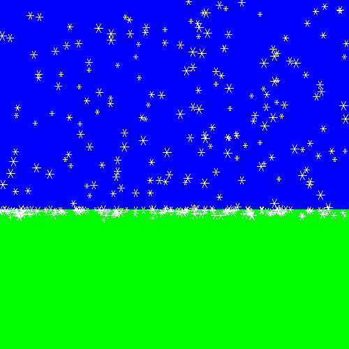

# ❄️ Pygame Snowfall

> 🎓 Rebuilt and extended from a lab for **CS 172** at **Drexel University**

An animated winter scene in Pygame. Snowflakes drift down from the sky at different sizes and speeds, and instead of disappearing when they hit the ground, they pile up into a layer of snow.



## Controls

| Key | Action |
|---|---|
| `Space` | Pause / resume the snow |
| `Q` | Quit |

## How it's built

The project is a small object-oriented design around one abstract class:

- **`Drawable`** (abstract): anything with a location and a `draw()` method. The `x`/`y` position is private, so subclasses go through `getLoc()` and `setLoc()`.
- **`Rectangle`**: a filled box, used for the sky and the ground
- **`Snowflake`**: a six-armed flake with its own size and fall speed. It moves down every frame until it lands, then stays put.

`main.py` keeps every object in one list, adds a new snowflake each frame, and draws everything in order: sky, ground, then snow.

## Run it

```bash
pip install pygame
python main.py
```

## Built with

Python · Pygame · abstract classes and inheritance
